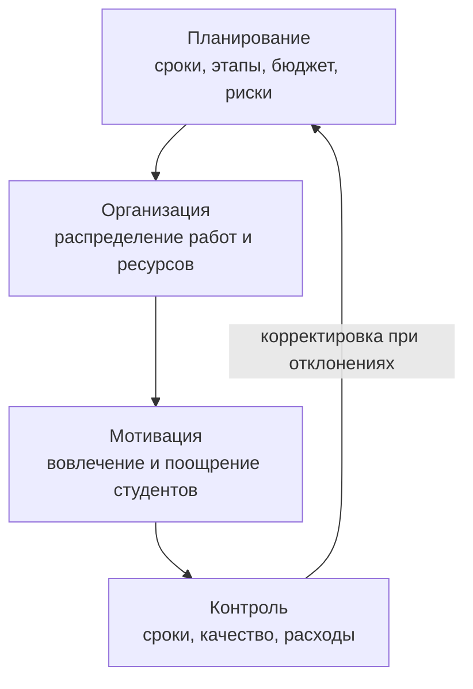
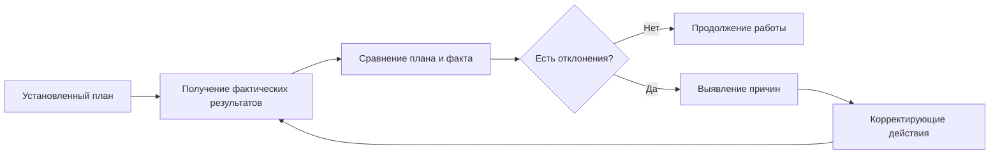

# Задание 1. Соотнеси функцию и действие

| Действие                                            | Функция менеджмента | Почему                                                                   |
| --------------------------------------------------- | ------------------- | ------------------------------------------------------------------------ |
| Утвердить штатное расписание                        | **Организация**     | Определяется структура персонала, должности и распределение обязанностей |
| Установить квартальные KPI                          | **Планирование**    | Заранее устанавливаются цели и показатели, которых нужно достичь         |
| Провести внеплановую проверку качества продукции    | **Контроль**        | Проверяется фактическое качество и соответствие требованиям              |
| Объявить благодарность сотруднику на общем собрании | **Мотивация**       | Нематериальное поощрение работника                                       |
| Составить бюджет отдела на год                      | **Планирование**    | Определяются будущие расходы, ресурсы и финансовые ограничения           |
| Назначить ответственного за задачу                  | **Организация**     | Распределяются ответственность и полномочия                              |
| Сравнить фактические продажи с планом               | **Контроль**        | Фактические результаты сопоставляются с запланированными                 |
| Предложить сотруднику обучение за счёт компании     | **Мотивация**       | Создаются стимулы для развития и профессионального роста                 |

### Итог по функциям

|Функция|Действия|
|---|---|
|**Планирование**|установить квартальные KPI; составить бюджет отдела на год|
|**Организация**|утвердить штатное расписание; назначить ответственного за задачу|
|**Мотивация**|объявить благодарность сотруднику; предложить обучение за счёт компании|
|**Контроль**|провести проверку качества; сравнить фактические продажи с планом|

### Где есть граница между функциями

Некоторые действия могут относиться сразу к нескольким функциям. Например, **KPI** устанавливаются при планировании, но затем используются при контроле. **Обучение сотрудника** может быть элементом организации работы с персоналом, но в данном случае прежде всего выступает способом мотивации.

---

# Задание 2. Мини-кейс «Ремонт в учебной мастерской»

**Ситуация:** в колледже необходимо отремонтировать учебную мастерскую. Бюджет ограничен, ремонт нужно закончить до начала семестра, часть работ выполняют студенты под руководством мастера.

|Функция|Конкретные действия|
|---|---|
|**Планирование**|1. Определить срок окончания ремонта и разбить работу на этапы. 2. Составить смету и определить максимально допустимый бюджет. 3. Определить основные риски: задержка материалов, нехватка денег, нарушение сроков.|
|**Организация**|1. Распределить работы между мастером, студентами и подрядчиками. 2. Назначить ответственных за отдельные этапы ремонта. 3. Закупить и распределить материалы, инструменты и оборудование.|
|**Мотивация**|1. Объяснить студентам практическую пользу участия в ремонте и возможность получить профессиональный опыт. 2. Объявить благодарность или отметить лучших участников. 3. Доверить наиболее ответственным студентам более сложные работы под контролем мастера.|
|**Контроль**|1. Еженедельно проверять выполнение работ по графику. 2. Проверять качество выполненных работ и соблюдение техники безопасности. 3. Сравнивать фактические расходы со сметой и процент выполненных работ с планом.|

### Возможные показатели контроля

|Показатель|Что проверяем|
|---|---|
|Выполнение работ, %|Насколько ремонт соответствует графику|
|Фактические расходы|Не превышен ли бюджет|
|Количество выявленных дефектов|Качество ремонта|
|Выполнение этапов в срок|Соблюдение сроков|
|Нарушения техники безопасности|Безопасность работ|

Схематично процесс выглядит так:

---

# Задание 3. Найди ошибку в описании функции

### Исходное описание

> «Контроль — это когда руководитель следит за сотрудниками, чтобы они не опаздывали и не отвлекались. Главное — строгость и наказания за нарушения».

### Ошибки

|Ошибка|Почему это неверно|
|---|---|
|Контроль сводится только к наблюдению за дисциплиной сотрудников|Контроль охватывает не только поведение работников, но также качество, сроки, затраты, объёмы работ и достижение целей|
|Главным названы строгость и наказания|Главная задача контроля — обнаружить отклонения от плана, определить причины и принять корректирующие решения; наказание не является обязательной целью контроля|

### Правильный вариант

**Контроль** — это функция менеджмента, заключающаяся в сравнении фактических результатов с запланированными, выявлении отклонений и принятии необходимых корректирующих решений.

**Пример:** если по плану мастерскую нужно отремонтировать на 70% к определённой дате, а фактически выполнено только 50%, задача контроля — не просто наказать исполнителей, а выяснить причину отставания и принять меры: изменить график, перераспределить людей, ускорить закупку материалов и т. д.