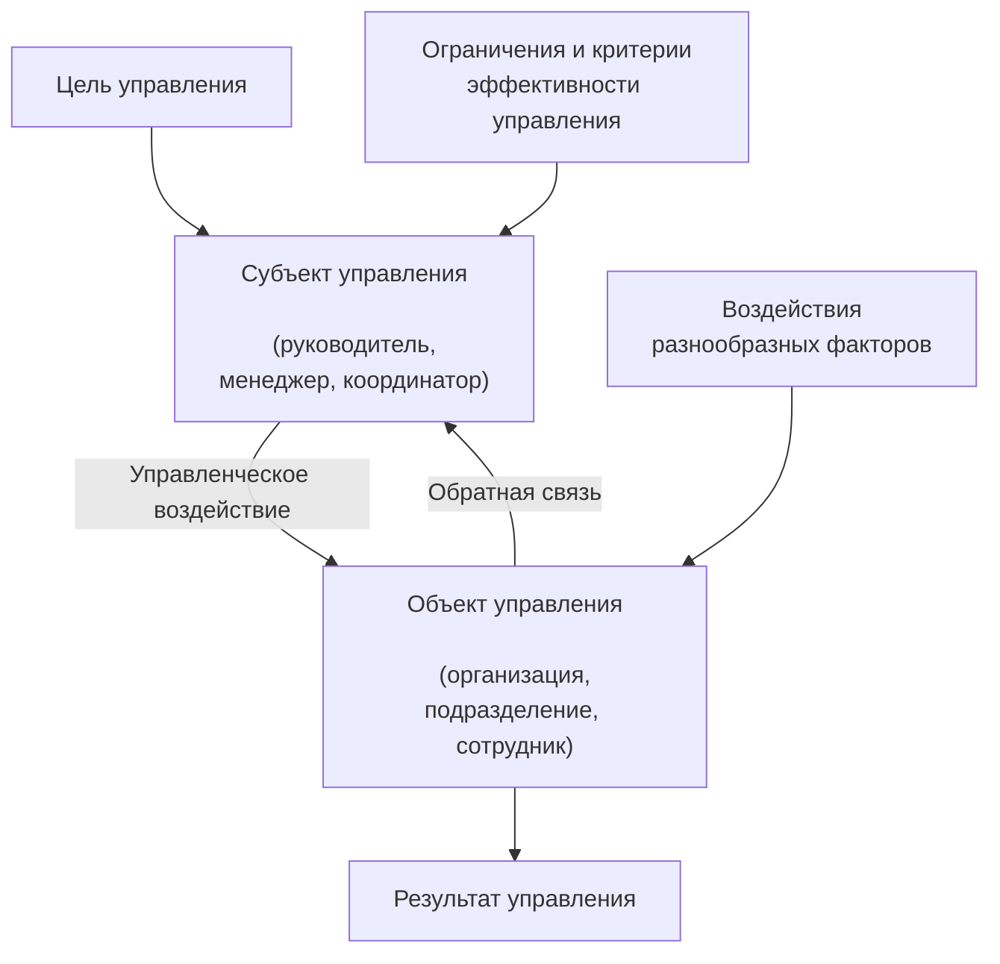
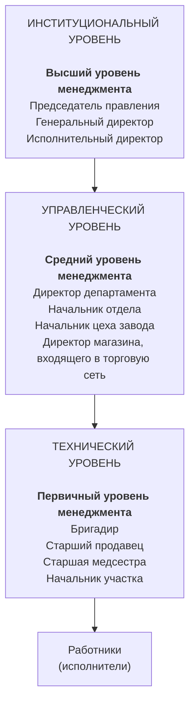
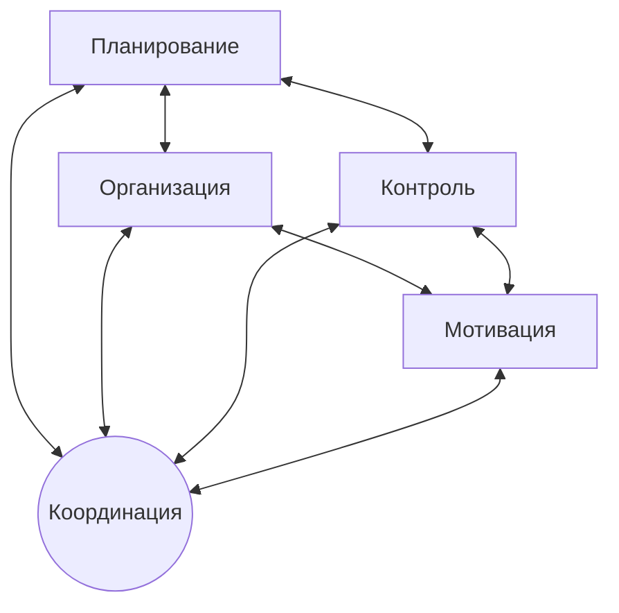
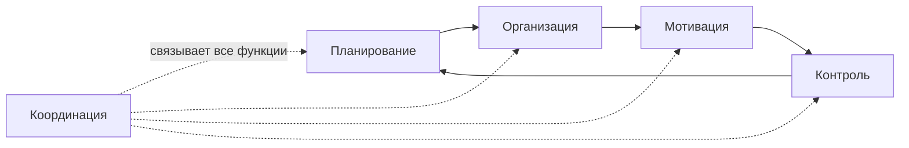

# Функции и уровни и менеджмента Виды управления 

## 2.1. Сравнение понятий «менеджмент» и «управление»

**Термин «менеджмент»** означает профессиональную деятельность — результативное и эффективное управление организациями.

**Менеджмент** (от англ. _management_ — управление, руководство, администрирование) — это профессиональная деятельность по управлению организациями, обеспечивающая высокую результативность и эффективность их работы в ближайшей и долгосрочной перспективе, а также целенаправленное и устойчивое развитие.

**Управление** — это целенаправленное воздействие на управляемый объект (организацию, подразделение, сотрудников, процессы) со стороны субъекта управления (менеджеров, руководителей) в условиях ограничений и в соответствии с выбранным критерием эффективности и реализуется через приказы, распоряжения, планы, нормы, регламенты, контрольные функции, мотивационные и стимулирующие процедуры, межличностное общение и т. п.

В самом общем и простейшем случае процесс управления можно проиллюстрировать следующей схемой (рис. 2.1).

- Под **критерием эффективности управления** понимается какой-либо показатель, характеризующий успешность работы организации после того или иного управленческого воздействия на нее.
    
- Так, например, в результате грамотных действий менеджеров могут значительно повыситься объемы производства и продаж продукции, увеличиться выручка компании, снизиться текучесть кадров, улучшиться морально-психологический климат в коллективе и т. п.
    
- Часто, говоря об успешности управленческих решений, принимаемых менеджментом, используют понятия **«результативность»** и **«эффективность»**.  
    **Результативность** — это достижение организацией поставленной цели (например, удвоение объема выручки компании).  
    **Эффективность** — это способ достижения цели, образно говоря — путь, который пришлось пройти компании. Иначе говоря, эффективность — это отношение ценности полученного результата к затратам на его достижение.
    
- Под **ограничениями** понимаются те условия (ситуации), в которых в данный момент принимается управленческое решение.
    
- Так, например, решение оборудовать производство новыми станками может быть ограничено отсутствием необходимых финансовых ресурсов, а решение применить штрафные санкции по отношению к сотрудникам — законами государства и т. п.
    
- Важным элементом процесса управления является **обратная связь** — передача информации (результатов работы, уточнений, предложений, отчетов и т. п.) от объекта к субъекту управления. Обратная связь — это осуществление менеджером контроля за работой подчиненных, а также возможность узнавать их мнение и предложения. Без обратной связи менеджер лишается возможности эффективно управлять объектом.

## Управление

- **Управление** — это процесс рационального распределения ресурсов организации с заданной целью, по разработанному плану, с непрерывным контролем результатов.
    
- Итак, управлять целой организацией, её отдельным подразделением или одним сотрудником — это значит оказывать на них **управленческое воздействие**, т. е. отдавать распоряжения, формировать требования и планы, убеждать или просто беседовать с людьми.
    
- При этом важно, чтобы **«субъект управления»** — тот, кто управляет, — имел чёткие ответы на следующие вопросы:
    

1. **Какова цель управления?**  
    Что требуется сейчас от организации? Чего я хочу добиться от своих подчинённых? К чему мы должны прийти?
    
2. **Каково сегодняшнее состояние организации (подразделения)?**  
    Каких результатов мы уже достигли?
    
3. **Каковы критерии эффективности управления?**  
    Какой результат нашей работы мы будем считать успешным?
    
4. **Какие ограничения накладываются на управление?**  
    Какие приказы и распоряжения я могу издавать, а какие нет? Уместно ли сейчас вообще приказывать людям или лучше просто побеседовать с ними? Хватит ли у нашей организации денег, времени, людей и т. п. на то, чтобы реализовать задуманное?
    

**Конечной целью деятельности менеджмента любой фирмы является обеспечение прибыльности или доходности от её деятельности путём рациональной организации производственного процесса.**

Эта деятельность включает не только управление производством и развитие технико-технологической базы, но и рациональное использование кадрового потенциала, повышение квалификации, творческой активности и лояльности каждого работника.

---

## Ресурсы организации

Какими же ресурсами управляет менеджер в организации? При всём разнообразии их можно разделить на пять групп:

1. **Материальные** — здания, оборудование, расходные материалы, сырьё, необходимое для производства продукции и т. п.
    
2. **Финансовые** — наличные деньги, ценные бумаги, счета в банках и т. п.
    
3. **Человеческие** — работники, персонал организации.
    
4. **Информационные** — базы данных, сведения, знания, технологии, инструкции и т. п.
    
5. **Временные** — рабочее время.
    

Если управление осуществляется профессионально и эффективно, то появляется **результат** — продукция, которую производит предприятие, или услуги, оказываемые клиентам.

---

## Аспекты менеджмента

Менеджмент характеризуется четырьмя аспектами:

- экономическим;
    
- социально-психологическим;
    
- правовым;
    
- организационно-техническим.
    

### Экономический аспект

Представляет собой управление процессом производства за счёт грамотной координации материальных, финансовых и трудовых ресурсов, необходимых для эффективного достижения целей.

### Социально-психологический аспект

Характеризует деятельность по управлению усилиями персонала фирмы для достижения поставленных целей.

Этот аспект включает в себя такие понятия, как:

- система власти, посредством которой регулируются отношения между руководителем и подчинёнными;
    
- социальная функция менеджмента, отражающая культуру общества, его традиции, ценности и обычаи.
    

### Правовой аспект

Отражает структуру и принципы государственных, политических и экономических институтов общества, проводимую ими политику и определяемое ими законодательство.

### Организационно-технический аспект

Состоит в:

- рациональной оценке ситуации;
    
- систематизированном выборе целей и задач;
    
- разработке стратегий достижения этих задач;
    
- подборе и использовании требуемых ресурсов;
    
- проектировании, организации и контроле за действиями, необходимыми для достижения целей.
    

**Менеджер** — наёмный специалист, занятый профессиональной управленческой деятельностью в аппарате управления организации, обладающий специальными компетенциями и наделённый для этого властными полномочиями.

---

# 2.3. Система менеджмента в организации

**Система менеджмента организации** — это совокупность должностных лиц, совместная работа которых обеспечивает результативное и эффективное управление организацией, а также особые формы и методы управленческой деятельности, принятые в данной организации.

- **Элементами системы менеджмента организации являются менеджеры**, каждый из которых отвечает за свою часть управленческой деятельности.
    
- **Структурное разделение труда менеджеров** строится исходя из масштабов, сфер деятельности, организационной структуры и специфики предприятия.
    

Наверное, почти невозможно найти две организации, даже очень похожие по профилю своей деятельности, у которых были бы совершенно одинаковые системы менеджмента. Они будут различаться наличием или отсутствием тех или иных управленческих должностей, разным распределением между менеджерами задач и ответственности, особенностями принятия важных решений, даже формами общения между руководителями и подчинёнными.

Тем не менее все системы менеджмента, иначе говоря **системы управления организациями**, имеют общие черты. Такими чертами являются **вертикальное и горизонтальное разделение труда менеджеров**.

### Вертикальное разделение труда менеджеров

Это условное выделение в организации трёх уровней управления:

1. низшего (первичного);
    
2. среднего;
    
3. высшего.
    

Такое разделение часто называют **иерархией власти в организации**.

### Горизонтальное (функциональное) разделение

Представляет собой выделение групп менеджеров, относящихся к одному уровню управления и управляющих подразделениями или отвечающих за определённые функциональные направления деятельности организации.

---

## Функциональные направления деятельности организации

К наиболее общим функциональным направлениям деятельности любой хозяйственной организации относятся:

- **производственная деятельность** — в непроизводственных компаниях эта деятельность называется операционной;
    
- **коммерческая деятельность** — продажа производимой продукции;
    
- **маркетинг** — изучение рынка;
    
- **управление финансами компании**;
    
- **управление персоналом компании** — человеческими ресурсами.
    

**Таким образом, в самом общем случае система менеджмента организации представляет собой взаимосвязанную работу групп менеджеров, отвечающих за определённые функции на определённых уровнях управления.**

Рассмотрим подробнее уровни управления организацией _(рис. 2.3)._

# 2.3. Система менеджмента в организации

**Система менеджмента организации** — это совокупность должностных лиц, совместная работа которых обеспечивает результативное и эффективное управление организацией, а также особые формы и методы управленческой деятельности, принятые в данной организации.

**Элементами системы менеджмента организации являются менеджеры**, каждый из которых отвечает за свою часть управленческой деятельности.

**Структурное разделение труда менеджеров строится исходя из масштабов, сфер деятельности, организационной структуры и специфики предприятия.**

Наверное, почти невозможно найти две организации (даже очень похожие по профилю своей деятельности), у которых были бы совершенно одинаковые системы менеджмента. Они будут различаться наличием или отсутствием тех или иных управленческих должностей, разным распределением между менеджерами задач и ответственности, особенностями принятия важных решений, даже формами общения между руководителями и подчинёнными.

Тем не менее все системы менеджмента, иначе говоря системы управления организациями, имеют общие черты. Такими чертами являются **вертикальное и горизонтальное разделение труда менеджеров**.

**Вертикальное разделение труда менеджеров** — это условное выделение в организации трёх уровней управления: низшего (первичного), среднего и высшего. Такое разделение часто называют **иерархией власти в организации**.

**Горизонтальное (функциональное) разделение** представляет собой выделение групп менеджеров, относящихся к одному уровню управления и управляющих подразделениями или отвечающих за определённые функциональные направления деятельности организации.

---

# Уровни управления организацией

**Рис. 2.3 — Уровни управления организацией**

Иерархию управления можно представить следующим образом:

| Уровень | Уровень менеджмента | Примеры должностей |
|---|---|---|
| Институциональный | Высший | Председатель правления, генеральный директор, исполнительный директор |
| Управленческий | Средний | Директор департамента, начальник отдела, начальник цеха завода, директор магазина |
| Технический | Первичный | Бригадир, старший продавец, старшая медсестра, начальник участка |
| Исполнительский | Работники | Работники (исполнители) |

---

# Руководители среднего уровня

**Руководители среднего уровня (middle managers)**, как правило, возглавляют крупные подразделения компании (департаменты, отделы). Они отвечают за практическую реализацию стратегических планов, разработанных высшим руководством.

Руководители среднего уровня формируют **тактические планы** и управляют реализацией тактических решений в масштабах своих подразделений или бизнес-функций.

Типичными должностями руководителей среднего звена являются:

- директора крупных департаментов;
- на заводах — начальники цехов;
- в торговых сетях — директора магазинов;
- в поликлиниках — заместители главного врача;
- в институтах — деканы факультетов.

---

# Руководители низового уровня

**Руководители низового уровня (first-line managers — менеджеры первичного уровня)** являются младшими начальниками в организации. Их также часто называют **операционными менеджерами**.

Первичный уровень — это организационный уровень, отвечающий за непосредственное управление работниками — сотрудниками организации, занимающими исполнительские должности.

Руководители первичного уровня осуществляют контроль над выполнением производственных и иных заданий, отвечают за грамотное использование выделенных ресурсов:

- материалов;
- оборудования;
- рабочего времени.

Типичными должностями на данном уровне являются, например:

- на заводе — старший мастер;
- в магазине — старший продавец-консультант;
- в поликлинике — старшая медсестра;
- в институте — заведующий кафедрой.

Особенностью этого уровня управления является то, что менеджеры здесь нередко сами выполняют разнообразные производственные задания, совмещая функции **руководителей и исполнителей**.

---

# Функциональные направления деятельности организации

К наиболее общим функциональным направлениям деятельности любой хозяйственной организации относятся:

- **производственная деятельность**  
  (в непроизводственных компаниях эта деятельность называется операционной);

- **коммерческая деятельность**  
  (продажа производимой продукции);

- **маркетинг**  
  (изучение рынка);

- **управление финансами компании**;

- **управление персоналом компании**  
  (человеческими ресурсами).

**Таким образом, в самом общем случае система менеджмента организации представляет собой взаимосвязанную работу групп менеджеров, отвечающих за определённые функции на определённых уровнях управления.**

---

# Взаимосвязь основных функций менеджмента

К основным функциям менеджмента относятся:

1. **планирование**;
2. **организация**;
3. **мотивация**;
4. **контроль**;
5. **координация**, обеспечивающая взаимосвязь всех остальных функций.

**Рис. 2.4 — Взаимосвязь основных функций менеджмента**

Основные функции менеджмента не существуют изолированно. Они образуют единый непрерывный управленческий процесс:

Планирование определяет цели и способы их достижения, организация обеспечивает распределение работ и ресурсов, мотивация побуждает сотрудников к выполнению поставленных задач, а контроль позволяет оценить полученные результаты и при необходимости скорректировать дальнейшие действия.

**Координация** обеспечивает согласование действий и взаимосвязь всех функций менеджмента.

# Основные функции менеджмента

## Планирование

**Планирование** — это процесс разработки планов организации, т. е. такой этап управления, на котором определяются:

1. **цели деятельности организации;**
2. **ресурсы, необходимые для достижения этих целей;**
3. **способы достижения поставленных целей.**

Планирование представляет собой начальный этап управления, на котором важно понимать, какие ресурсы (оборудование, деньги, специалисты, технологии и т. п.) выделяются для достижения этой цели и как они будут использоваться.

Одним из главных элементов любого плана является указание на **сроки выполнения каждого его пункта (сроки достижения целей).**

Наличие правильно составленного плана позволяет перейти к следующему этапу управления — **организации** (иначе говоря — организовыванию) работы.

Термин **«организация»** в менеджменте используется в двух значениях:

1. **организация как объект управления** — компания, предприятие;
2. **организация как функция менеджмента** — процесс организационной деятельности.

---

## Организация

**Организация** — это функция, заключающаяся в правильном распределении задач, ресурсов, полномочий и ответственности между исполнителями и обеспечении высокой эффективности их совместной работы.

Когда организационные задачи касаются всего предприятия в целом (или его крупных частей), то говорят, что менеджмент формирует **организационную структуру компании**.

Поэтому **функция организации** — это ещё и процесс разработки организационной структуры предприятия.

Выбор правильной организационной структуры и рациональное распределение между сотрудниками задач, полномочий и ресурсов позволяют приступить к работе.

Однако эта работа будет результативной и эффективной только в том случае, если исполнители (да и руководители тоже) будут:

- понимать свою выгоду от успешной работы;
- видеть перспективы своего развития;
- соглашаться с установленными в компании порядками;
- принимать её нравственные ценности.

Обеспечить выполнение этих сложных условий в коллективе можно только путём специальной работы, которая называется **мотивированием**, или **стимулированием персонала**, или просто **мотивацией**.

---

## Мотивация

**Мотивация (как функция менеджмента)** — это активизация деятельности персонала и побуждение его к результативному и эффективному труду для достижения целей организации.

С помощью этой функции менеджмент создаёт условия работы на предприятии, в которых становится **выгодно и удобно работать всему коллективу**.

Строго говоря, слово **«мотивация»** означает особое внутреннее (психологическое) состояние человека, побуждающее его действовать определённым образом.

Однако **в менеджменте этим термином обозначается одна из функций управления — действия руководителя, направленные на формирование таких мотивов поведения сотрудников, которые побуждали бы их действовать не только в своих интересах, но и в интересах компании.**

Если сотрудники осознают свою выгоду, понимают и принимают цели и ценности своей компании, то значительно повышается их сознательность и производительность труда.

Тем не менее нормальная работа любого предприятия или подразделения невозможна без осуществления **контроля**.
