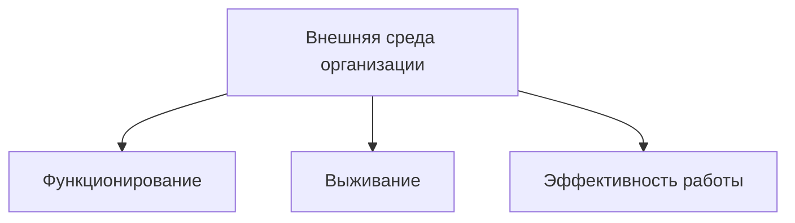
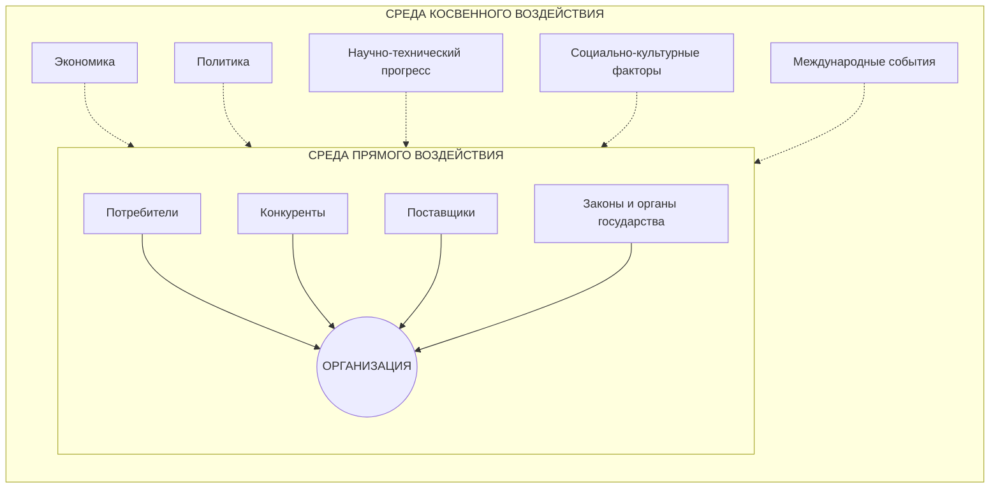
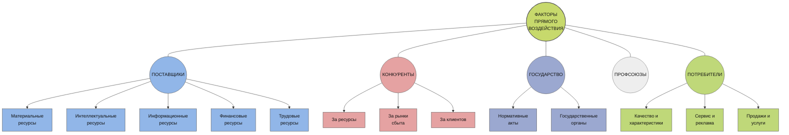
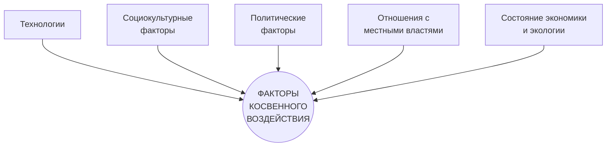
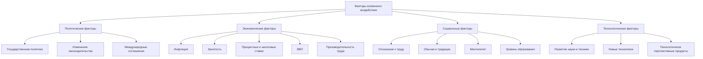
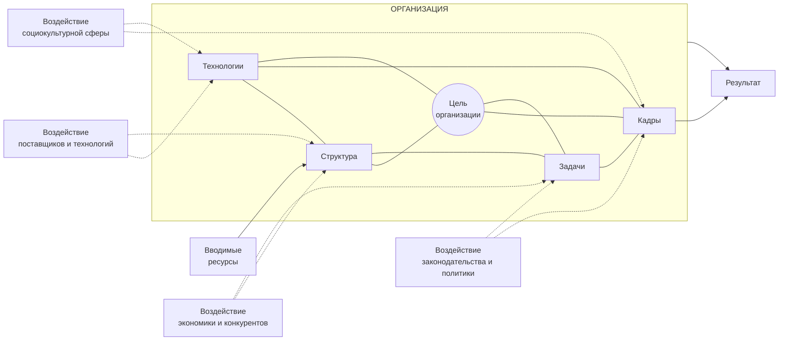
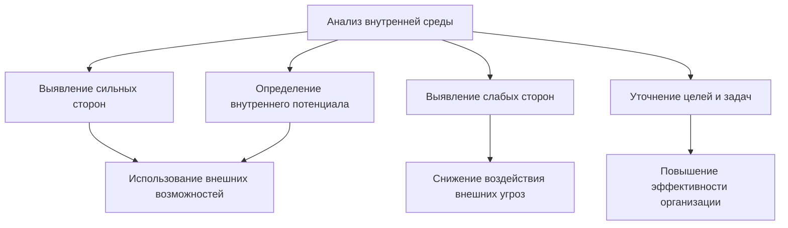
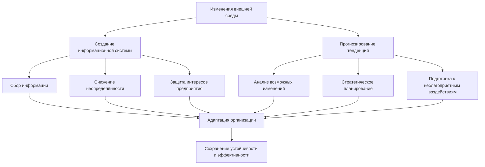
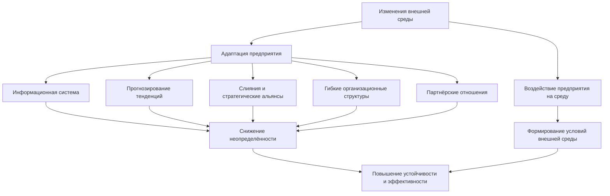

# Внешняя и внутренняя среда организации

## План лекции

### 1. Внешняя и внутренняя среда организации
- значение внутренней и внешней среды;
- организационные формы и структуры;
- функции и технологии управления;
- факторы прямого и косвенного воздействия;
- инструменты анализа.

### 2. Внешняя и внутренняя среда маркетинга

### 3. Внешняя среда организации
- характеристика внешней среды;
- среда прямого воздействия;
- среда косвенного воздействия;
- задачи организации;
- модель внешней среды.

### 4. Внутренняя среда организации
- характеристика;
- значение;
- основные элементы;
- инструменты анализа.

### 5. Адаптация организации

### 6. Инструменты анализа

### 7. Методы анализа внутренней и внешней среды

---

## Общая характеристика организации

Все организации отличаются друг от друга по различным аспектам. Вместе с тем они имеют общие для всех организаций характеристики.

> **Одной из самых значительных характеристик организации является зависимость от внешней и внутренней среды.**

---

## Внешняя среда организации

**Внешняя среда организации** — это совокупность условий и факторов, возникающих независимо от деятельности организации и оказывающих существенное воздействие на неё.

### Значение внешней среды

Факторы внешней среды влияют на:

- функционирование организации;
- её выживание;
- эффективность её работы.

### Схема

## Характеристики внешней среды организации

- **Взаимосвязанность факторов** — сила, с которой изменение одного фактора воздействует на другие.

- **Сложность** — большое число факторов, значительным образом влияющих на организацию.

- **Подвижность** — относительная скорость изменения среды.

- **Неопределённость** — относительное количество информации о среде и уверенности в её релевантности.

## Внешняя среда

**Внешняя среда делится на:**

### 1. Среду прямого воздействия

**Среда прямого воздействия** — факторы, которые непосредственно влияют на деятельность организации:

- поставщики;
- акционеры;
- трудовые ресурсы;
- законы и государственные органы;
- профсоюзы;
- потребители;
- конкуренты.

### 2. Среду косвенного воздействия

**Среда косвенного воздействия** — факторы, которые могут не оказывать прямого немедленного воздействия на организацию, но сказываются на её функционировании:

- система ценностей и их приоритеты в обществе;
- социальные и политические нормы местного и международного делового оборота;
- политическая обстановка в стране и мире;
- экономическая обстановка;
- природные и общественные катаклизмы.

## Модель внешней среды организации

### Среда прямого воздействия
- потребители;
- конкуренты;
- поставщики;
- законы и органы государства.

### Среда косвенного воздействия
- экономика;
- политика;
- научно-технический прогресс;
- социально-культурные факторы;
- международные события.

## Факторы прямого воздействия

К основным факторам **прямого воздействия внешней среды** относятся:

- поставщики;
- конкуренты;
- государство;
- профсоюзы;
- потребители.

### Схема факторов прямого воздействия

### Поставщики

Поставщики обеспечивают организацию необходимыми ресурсами:

- материальными;
- интеллектуальными;
- информационными;
- финансовыми;
- трудовыми.

### Конкуренты

Конкурентная борьба может происходить:

- **за ресурсы**;
- **за рынки сбыта**;
- **за клиентов**.

### Государство

Воздействие государства осуществляется через:

- нормативные акты;
- государственные органы.

### Профсоюзы

**Профсоюзы** воздействуют на организацию через представление и защиту интересов работников.

### Потребители

Потребители оказывают непосредственное влияние на деятельность организации через свои требования к:

- качеству и характеристикам продукции;
- сервису;
- условиям приобретения товаров и услуг.

## Среда / факторы косвенного воздействия

К основным **факторам косвенного воздействия** относятся:

- технологии;
- социокультурные факторы;
- политические факторы;
- отношения с местными властями;
- состояние экономики и экологии.

### Схема факторов косвенного воздействия

## Факторы косвенного воздействия внешней среды

### Политические факторы

К политическим факторам относятся:

- основные направления государственной политики и методы её реализации;
- возможные изменения в законодательной и нормативно-технической базе;
- международные соглашения, заключаемые правительством в области тарифов и торговли;
- другие решения органов государственной власти, способные повлиять на деятельность организации.

### Экономические факторы

К экономическим факторам относятся:

- темпы инфляции;
- уровень занятости трудовых ресурсов;
- международный платёжный баланс;
- процентные ставки;
- налоговые ставки;
- величина и динамика ВВП;
- производительность труда и т. д.

---

## Социальные факторы внешней среды

К социальным факторам относятся:

- отношение населения к работе и качеству жизни;
- обычаи и традиции, существующие в обществе;
- менталитет общества;
- уровень образования и т. п.

---

## Технологические факторы

**Технологические факторы** — это возможности, связанные с развитием науки и техники, которые позволяют:

- оперативно перестроиться на производство и реализацию технологически перспективного продукта;
- внедрять новые технологии;
- прогнозировать момент отказа от используемой технологии.

---

## Факторы косвенного воздействия — краткая схема

## Модель влияния внешней среды на организацию

### Основные элементы модели

**Вход организации:**
- вводимые ресурсы.

**Внутренняя среда организации:**
- цель организации;
- структура;
- технологии;
- кадры;
- задачи.

**Факторы внешней среды:**
- воздействие поставщиков и технологий;
- воздействие экономики и конкурентов;
- воздействие социокультурной сферы;
- воздействие законодательства и политики.

**Выход организации:**
- результат.

## Внутренняя среда организации

**Внутренняя среда** — это та часть общей среды, которая находится в рамках организации.

Это среда, которая определяет технические и организационные условия работы организации и является результатом управленческих решений.

Организация анализирует внутреннюю среду с целью выявления **слабых и сильных сторон** её деятельности.

Это необходимо потому, что организация не может воспользоваться внешними возможностями без наличия определённого внутреннего потенциала. При этом ей необходимо знать свои слабые места, которые могут усугубить внешнюю угрозу и опасность.

> **Внутренняя среда оказывает постоянное и самое непосредственное воздействие на функционирование организации.**

---

## Значение анализа внутренней среды

Анализ внутренней среды имеет важное значение для управления организацией:

- информация о внутренней среде фирмы необходима менеджеру, чтобы определить **внутренние возможности и потенциал**, на которые фирма может рассчитывать в конкурентной борьбе для достижения поставленных целей;

- анализ внутренней среды позволяет лучше уяснить **цели и задачи организации**;

- помимо производства продукции и оказания услуг, организация обеспечивает возможность существования своим работникам, создаёт определённые **социальные условия для их жизнедеятельности**.

### Схема анализа внутренней среды

---

# Адаптация организации

**Адаптация организации** реализуется через следующие инструменты.

## 1. Создание информационной системы

Создание информационной системы позволяет:

- получать информацию об изменениях, произошедших у основных контрагентов предприятия;

- снижать неопределённость на входах и выходах;

- защищать и реализовывать интересы предприятия во внешней среде.

Деятельность по сбору информации осуществляется такими службами, как:

- снабжение;
- маркетинг;
- стратегическое планирование;
- логистика.

> Создание этих отделов требует значительных финансовых вложений.

---

## 2. Прогнозирование тенденций

**Прогнозирование тенденций развития внешней среды** и стратегическое планирование деятельности предприятия подготавливают предприятие к:

- возможным изменениям рыночной ситуации;
- неблагоприятным воздействиям внешнего окружения.

### Схема адаптации организации

## 3. Слияния, приобретение новых предприятий, образование стратегических альянсов

**Слияния, приобретение новых предприятий, образование стратегических альянсов** с другими предприятиями, в том числе с бывшими конкурентами.

Использование этого инструмента обеспечивает предприятие полноценными партнёрами для создания перспективных, стабильных, интегрированных:

- производственных;
- снабженческо-сбытовых;
- инвестиционных;
- инновационных структур.

### Значение данного инструмента

Он позволяет:

- **сокращать неопределённость среды** за счёт создания зоны стабильности;
- подготавливать предприятие к **труднопрогнозируемым изменениям ситуации**;
- ограничивать возможности **оппортунистического поведения партнёров**;
- снижать **трансакционные издержки**;
- находить новое место предприятия во внешней среде;
- обеспечивать **гибкость и адаптивность** предприятия;
- создавать предпосылки для влияния на внешнюю среду;
- способствовать образованию **синергетических эффектов**.

---

## 4. Гибкие организационные структуры

**Гибкие организационные структуры** являются инструментом приспособления предприятия к внешней среде.

Их значимость состоит в том, что структура определяет характер и количество **информационных и коммуникационных связей**:

- внутри предприятия;
- между предприятием и его контрагентами.

Гибкая адаптивная структура позволяет предприятию:

- эффективно реагировать на изменения, происходящие во внешней среде;
- осуществлять внутренние трансформации;
- быстро внедрять необходимые изменения;
- ориентироваться на **человеческий потенциал как основной ресурс предприятия**.

> **Гибкие организационные структуры ориентируют предприятие на освоение новых продуктов, новых рынков и новых технологий.**

---

## 5. Партнёрские отношения

**Партнёрские отношения между руководством предприятия и его персоналом** обеспечивают:

- взаимодействие экономических агентов внутри предприятия;
- интеграцию внутренней среды;
- поддержание внутренней целостности организации.

---

## Влияние предприятия на внешнюю среду

Предприятие не только подчиняется существующим экономическим отношениям, но и **само формирует их**, создавая ту среду, в которой функционирует.

Влияние предприятия на среду возможно, когда оно:

- интегрирует в себя достаточное количество ресурсов;
- обладает высоким социально-экономическим потенциалом.

> **Предприятие предпочитает влияние на среду тогда, когда очередное приспособление к изменениям внешней среды оценивается им как более дорогостоящий процесс, чем изменение самого окружения.**

### Общая схема адаптации и влияния

