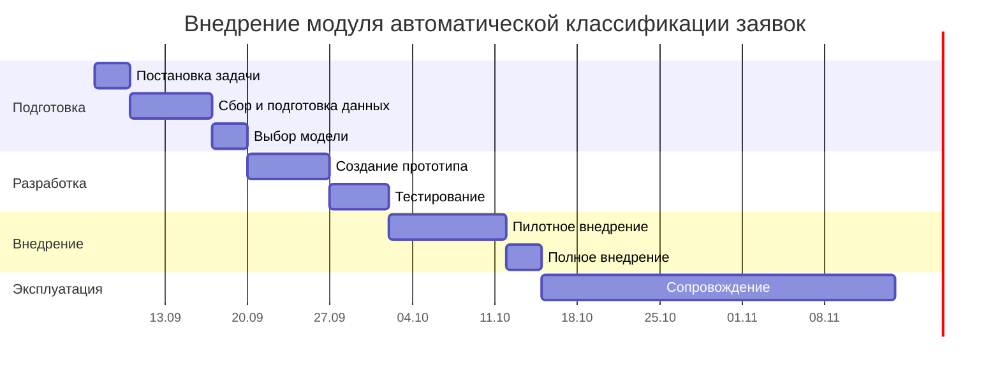

# Практическая работа №3
## План-график внедрения интеллектуального модуля

### Тема

Внедрение модуля автоматической классификации заявок в систему технической поддержки колледжа.

### Цель работы

Составить план внедрения интеллектуального модуля с учётом этапов жизненного цикла, ответственных сотрудников, сроков выполнения и возможных рисков.

---

## 1. Описание задачи

В колледже используется система технической поддержки, в которую сотрудники и преподаватели отправляют обращения о проблемах с компьютерами, программным обеспечением, сетью, учётными записями и другой ИТ-инфраструктурой.

Сейчас сотруднику технической поддержки необходимо вручную читать каждую заявку, выбирать её категорию и направлять нужному специалисту.

Предлагается внедрить интеллектуальный модуль, который будет анализировать текст заявки и автоматически определять её категорию.

Примеры категорий:

- проблемы с сетью;
- неисправность компьютера;
- проблемы с программным обеспечением;
- проблемы с учётной записью;
- неисправность принтера;
- доступ к информационным системам;
- прочее.

---

# 2. План жизненного цикла

В соответствии с жизненным циклом интеллектуальной системы внедрение состоит из восьми этапов.

| № | Этап | Что выполняется | Длительность | Ответственный | Ожидаемый результат |
|---:|---|---|---|---|---|
| 1 | Постановка задачи и сбор требований | Определяются категории заявок, требования к точности, порядок работы системы и критерии успешного внедрения | 3 дня | Руководитель ИТ-службы, системный аналитик | Утверждённое техническое задание |
| 2 | Сбор и подготовка данных | Выгружаются старые заявки, удаляются дубликаты и ошибочные записи, каждой заявке назначается правильная категория | 7 дней | Специалист техподдержки, аналитик данных | Подготовленный и размеченный набор данных |
| 3 | Выбор модели и метода | Выбирается метод классификации текстовых обращений и технология интеграции с существующей системой | 3 дня | ML-разработчик, системный аналитик | Выбран алгоритм и архитектура решения |
| 4 | Разработка прототипа | Создаётся первая версия классификатора и программный интерфейс для передачи текста заявки | 7 дней | ML-разработчик, программист | Работающий прототип |
| 5 | Тестирование | Модель проверяется на исторических заявках, измеряется точность, анализируются ошибки | 5 дней | Тестировщик, ML-разработчик, специалист техподдержки | Отчёт о качестве модели и исправленная версия |
| 6 | Пилотное внедрение | Модуль подключается для части новых заявок, при этом сотрудник подтверждает или исправляет категорию | 10 дней | Системный администратор, техподдержка, ML-разработчик | Проверка системы на реальных обращениях |
| 7 | Полное внедрение | Модуль подключается ко всем новым заявкам и используется в основном рабочем процессе | 3 дня | Системный администратор, разработчик | Интеллектуальный модуль работает в основной системе |
| 8 | Сопровождение и мониторинг | Контролируется качество классификации, собираются ошибки, при необходимости выполняется переобучение | Постоянно | Системный администратор, ML-разработчик, руководитель ИТ-службы | Стабильная работа и сохранение качества системы |

---

# 3. Подробное описание этапов

## Этап 1. Постановка задачи и сбор требований

На первом этапе необходимо определить, какую именно задачу должен выполнять интеллектуальный модуль.

Основная задача:

> По тексту обращения автоматически определить категорию заявки и передать её соответствующей группе технической поддержки.

Необходимо определить:

- перечень категорий заявок;
- минимально допустимую точность;
- время обработки одной заявки;
- порядок действий при низкой уверенности модели;
- возможность ручного исправления результата оператором.

### Результат

Формируется техническое задание на разработку интеллектуального модуля.

---

## Этап 2. Сбор и подготовка данных

Для обучения системы используются ранее обработанные заявки.

Из существующей системы технической поддержки выгружаются:

- текст обращения;
- выбранная оператором категория;
- дата обращения;
- итоговый тип проблемы.

Данные необходимо очистить.

Удаляются:

- пустые обращения;
- дубликаты;
- тестовые заявки;
- ошибочно классифицированные обращения;
- персональные данные, которые не нужны модели.

После этого формируется обучающая выборка.

### Результат

Готовый набор размеченных данных вида:

```text
"Не работает интернет в кабинете 302" -> Сеть
"Не могу войти в свою учетную запись" -> Учетная запись
"Компьютер не включается" -> Оборудование
```

---

## Этап 3. Выбор модели и метода

Для задачи необходимо использовать модель классификации текста.

Модель получает текст заявки и возвращает:

- предполагаемую категорию;
- степень уверенности.

Например:

```text
Вход:
"После смены пароля не могу войти в систему"

Результат:
Категория: Учетная запись
Уверенность: 94 %
```

Также определяется способ интеграции модели с системой технической поддержки.

### Результат

Выбран способ реализации и определена архитектура будущего решения.

---

## Этап 4. Разработка прототипа

Создаётся первая рабочая версия интеллектуального модуля.

Прототип должен:

1. получать текст заявки;
2. выполнять предварительную обработку текста;
3. передавать данные модели;
4. получать прогноз;
5. возвращать категорию;
6. возвращать уверенность модели.

На этом этапе модуль ещё не используется в рабочей системе колледжа.

### Результат

Работающий прототип классификатора.

---

## Этап 5. Тестирование

Для проверки используется часть исторических данных, которые модель не видела во время обучения.

Проверяются:

- общая точность;
- ошибки по отдельным категориям;
- скорость обработки;
- устойчивость к коротким и плохо написанным обращениям.

Особенно анализируются случаи, когда система путает похожие категории.

Например:

```text
"Не открывается сайт колледжа"
```

Это может быть как проблема сети, так и проблема конкретной информационной системы.

### Результат

Получена оценка качества и исправлены основные ошибки модели.

---

## Этап 6. Пилотное внедрение

Модель подключается к реальной системе, но используется только как помощник.

Например:

1. поступает новая заявка;
2. модель предлагает категорию;
3. оператор видит предложение;
4. оператор подтверждает или исправляет его.

Все исправления сохраняются.

Это позволяет проверить работу системы без риска полностью неправильной автоматической маршрутизации.

### Результат

Получена статистика работы модели на реальных данных.

---

## Этап 7. Полное внедрение

После успешного пилота система подключается ко всем входящим обращениям.

Если уверенность модели высокая, заявка автоматически отправляется нужной группе специалистов.

Если уверенность низкая, заявка передаётся оператору для ручной классификации.

Пример:

```text
Уверенность >= 85 % -> автоматическая классификация
Уверенность < 85 %  -> проверка сотрудником
```

### Результат

Система автоматически обрабатывает большую часть новых заявок.

---

## Этап 8. Сопровождение и мониторинг

После внедрения работа над системой не заканчивается.

Необходимо регулярно отслеживать:

- точность классификации;
- количество ручных исправлений;
- появление новых категорий;
- изменение формулировок заявок;
- ошибки модели.

Новые проверенные заявки можно добавлять в обучающий набор и периодически переобучать модель.

### Результат

Качество интеллектуальной системы сохраняется после внедрения.

---

# 4. План-график

Примерный общий срок до полного внедрения — **38 дней**, после чего начинается постоянное сопровождение.



> В Obsidian диаграмма отобразится автоматически, если включена поддержка Mermaid.

---

# 5. Риски и меры по их снижению

| № | Риск | Возможные последствия | Меры по снижению |
|---:|---|---|---|
| 1 | Недостаточно исторических заявок для некоторых категорий | Модель хорошо определяет популярные категории, но часто ошибается на редких | Собрать дополнительные примеры, объединить слишком редкие категории, использовать ручную классификацию при низкой уверенности |
| 2 | Ошибки в исходной разметке | Модель обучается на неправильных примерах и повторяет ошибки операторов | Перед обучением проверить выборку и вручную исправить часть данных |
| 3 | Изменение характера обращений со временем | Точность постепенно снижается из-за появления новых программ и новых типов проблем | Постоянно собирать новые заявки и периодически переобучать модель |
| 4 | Неправильная автоматическая маршрутизация критической заявки | Важная проблема может попасть не тому специалисту и увеличить время устранения | Критические заявки дополнительно проверять правилами и оператором |
| 5 | Сотрудники не доверяют системе | Операторы продолжают классифицировать всё вручную и эффект от внедрения снижается | Сначала использовать модель как рекомендательную систему и показывать сотруднику результат и уверенность |
| 6 | В заявках содержатся персональные данные | Возможна обработка лишней конфиденциальной информации | Удалять или маскировать персональные данные при подготовке обучающей выборки |

---

# 6. Связь рисков с кейсом Microsoft Tay

Кейс чат-бота Microsoft Tay показывает, что качество входных данных напрямую влияет на работу интеллектуальной системы.

Если без проверки использовать все обращения пользователей для автоматического дообучения классификатора, в обучающую выборку могут попасть:

- ошибочные категории;
- случайный текст;
- спам;
- некорректные обращения;
- специально созданные вредоносные примеры.

Поэтому новые данные нельзя автоматически использовать для обучения без проверки.

Основная мера:

> Новые заявки сначала проверяются сотрудником технической поддержки и только после подтверждения могут добавляться в обучающую выборку.

Таким образом, проблема должна предотвращаться прежде всего на этапе **сбора и подготовки данных**, а затем контролироваться на этапе **сопровождения**.

---

# 7. Вывод

Для внедрения модуля автоматической классификации заявок необходимо пройти все восемь этапов жизненного цикла интеллектуальной системы: от постановки задачи и подготовки данных до полного внедрения и последующего сопровождения.

Наиболее важным этапом является подготовка качественной обучающей выборки. Если исходные заявки имеют неправильные категории или содержат большое количество шума, модель будет повторять эти ошибки.

Безопаснее всего внедрять систему постепенно. Сначала модель должна работать в качестве помощника оператора, затем — автоматически классифицировать только те заявки, в которых она имеет высокую уверенность.

Такой подход позволяет сократить время обработки обращений и нагрузку на первую линию технической поддержки, сохранив возможность контроля со стороны человека.
