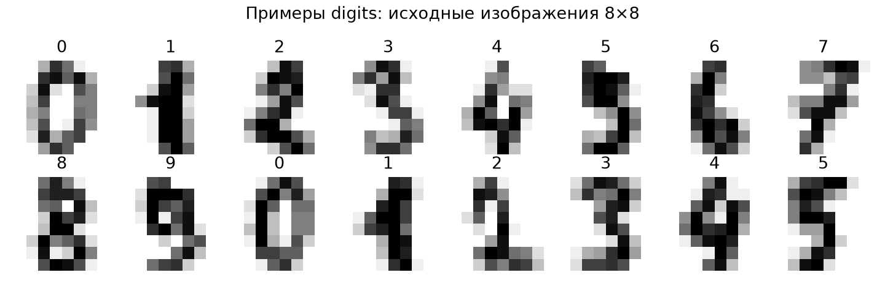
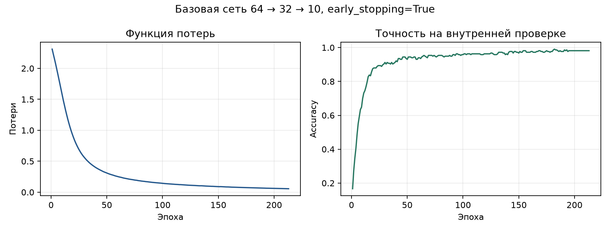
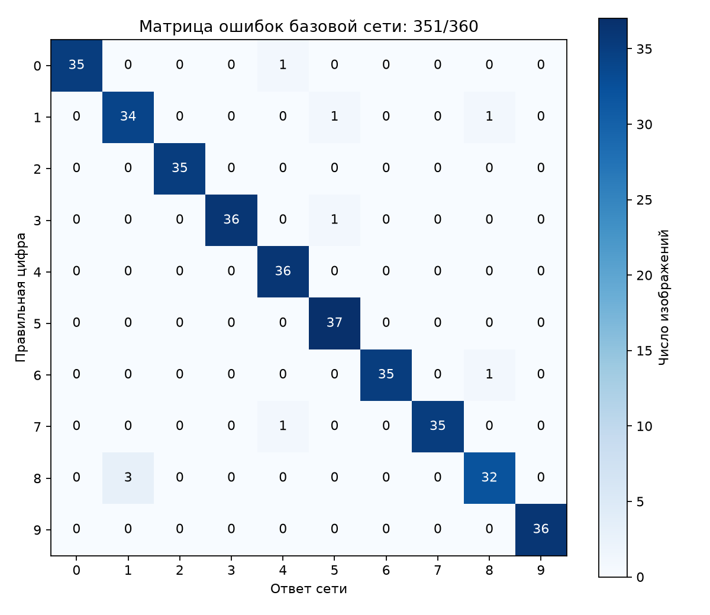
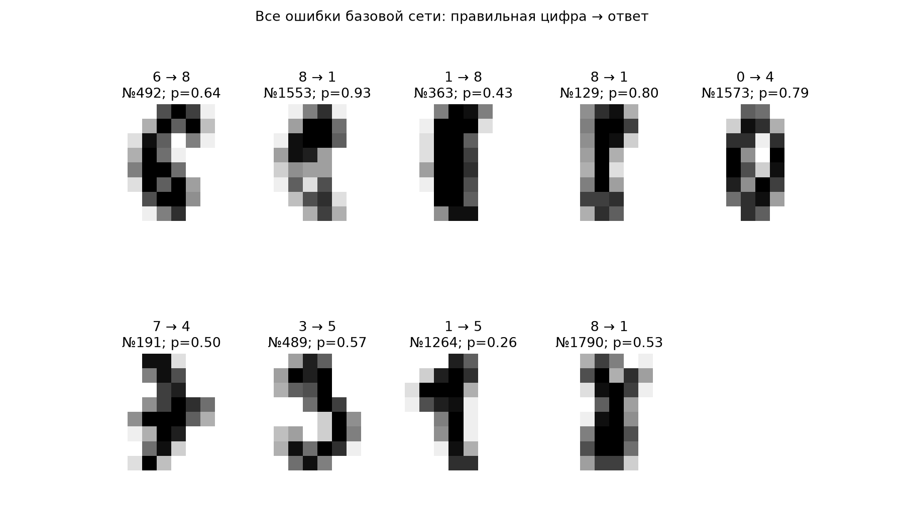
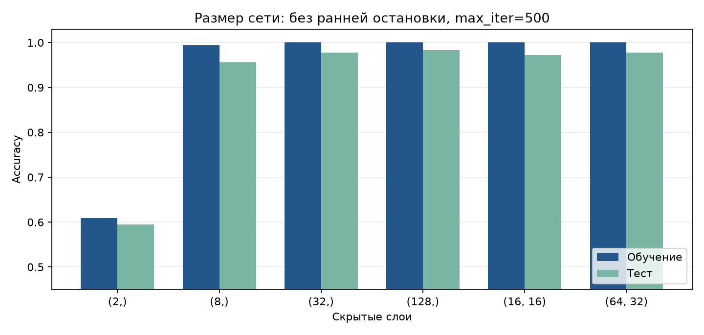

# Практическая работа № 3

**Нейронная сеть на Python: распознавание рукописных цифр**

Цель: обучить многослойную нейронную сеть, оценить её точность, изучить кривые обучения и ошибки, сравнить разные размеры скрытых слоёв.

Работа выполнена запуском [pr3_digits.py](3/pr3_digits.py) 13 ноября 2026 года. Все числа ниже получены в этом запуске. Полный вывод сохранён в [run_log.txt](3/run_log.txt), исходные метрики — в [metrics.json](3/metrics.json).

## 1. Загрузка и просмотр данных

Использован встроенный набор `sklearn.datasets.load_digits`: **1797 изображений** размером **8×8 пикселей**, классы — цифры от 0 до 9. Изображение преобразовано в 64 признака. Яркость нормализована выражением `X = digits.data / 16.0`, диапазон значений после нормализации — от 0 до 1.



Разделение выполнено строго по условию:

```python
train_test_split(X, y, test_size=0.2, random_state=42, stratify=y)
```

В обучающей выборке **1437** изображений, в тестовой — **360**. `stratify=y` сохраняет близкие доли классов. Все эксперименты используют одно и то же разделение; тестовые изображения в обучение не передаются.

## 2. Обучение базовой сети

Архитектура: **64 входа → 32 нейрона → 10 выходов**. Использован `MLPClassifier(hidden_layer_sizes=(32,), max_iter=500, early_stopping=True, validation_fraction=0.15, n_iter_no_change=30, random_state=42)`. Остальные параметры стандартные: `activation='relu'`, `solver='adam'`, `alpha=0.0001`, `tol=0.0001`.

| Показатель | Фактический результат |
|---|---:|
| Выполнено эпох | 213 |
| Точность на обучающей выборке | 0.989562, или 98.956% |
| Точность на тесте | 0.975000, или 97.500% |
| Правильно распознано на тесте | 351 из 360 |
| Ошибок на тесте | 9 |
| Лучшая точность внутренней проверки | 0.990741, или 214 из 216 |
| Первая эпоха с лучшей точностью проверки | 182 |
| Предупреждение о несходимости | Нет |

Для ранней остановки из 1437 обучающих изображений выделены 216 проверочных; веса обновлялись по оставшимся 1221. Показатель «точность на обучающей выборке» в таблице рассчитан на всех 1437 изображениях, включая внутреннюю проверочную часть, как в программе методички. Тестовая выборка от неё отделена.

## 3. Кривые обучения



Потери снизились с **2.310524** до **0.055897**. Точность на внутренней проверке быстро выросла, затем менялась медленно и вышла на плато. Последние эпохи уже не дали нового максимума. Обучение остановилось на 213-й эпохе, раньше ограничения в 500 эпох.

При ранней остановке scikit-learn восстанавливает веса с лучшим проверочным результатом. Поэтому последние точки графика потерь показывают ход обучения до остановки, а итоговые предсказания сделаны восстановленной моделью. Продолжать уменьшать потери без улучшения проверки в этом опыте не требовалось.

## 4. Матрица ошибок и перепутанные цифры



Строка матрицы — правильная цифра, столбец — ответ сети. На диагонали находятся 351 правильный ответ, вне диагонали — 9 ошибок. Все ненулевые пары ошибок:

| Правильная цифра → ответ | Число ошибок | Индексы изображений в исходном digits, начиная с 0 |
|---|---:|---|
| 8 → 1 | 3 | 1553, 129, 1790 |
| 0 → 4 | 1 | 1573 |
| 1 → 5 | 1 | 1264 |
| 1 → 8 | 1 | 363 |
| 3 → 5 | 1 | 489 |
| 6 → 8 | 1 | 492 |
| 7 → 4 | 1 | 191 |



На рисунке показаны именно ошибочные изображения тестовой выборки; подпись содержит правильную цифру, ответ сети, исходный индекс и вероятность выбранного ответа `p`. Эти же данные сохранены в [misclassified_digits.csv](3/misclassified_digits.csv).

Чаще всего сеть ошибалась **8 → 1**. У этих восьмёрок узкие петли и близкие вертикальные штрихи; при разрешении 8×8 они частично сливаются и напоминают единицу. Для 3 и 5 похожи нижнее закругление и центральный штрих, для 6 и 8 — округлые петли. У конкретной семёрки №191 выражен поперечный штрих, а у нуля №1573 форма угловатая, что делает ошибки на 4 объяснимыми. Это визуальная интерпретация примеров, а не доказательство внутренней причины решения сети.

У изображения №1553 неверный ответ 1 получил вероятность около **0.935**. Значит, высокая вероятность ответа модели сама по себе не гарантирует правильность.

## 5. Эксперимент с размером сети

Обучены четыре отдельные сети с `max_iter=500`, `early_stopping=False`, `random_state=42`. Для вариантов без ранней остановки сохранён стандартный `n_iter_no_change=10`: обучение может закончиться раньше 500 эпох по критерию изменения потерь. Точность на обучении рассчитана на всех 1437 изображениях.

| Нейронов скрытого слоя | Точность: обучение | Точность: тест | Верно на тесте | Эпох | Вывод |
|---:|---:|---:|---:|---:|---|
| 2 | 0.608907 | 0.594444 | 214/360 | 500 | Низкая точность и на обучении, и на тесте; выраженное недообучение при заданных условиях |
| 8 | 0.993737 | 0.955556 | 344/360 | 500 | Лучше сети из 2 нейронов; разрыв между обучением и тестом около 3.82 процентного пункта |
| 32 | 1.000000 | 0.977778 | 352/360 | 434 | Все обучающие примеры распознаны; на тесте 8 ошибок |
| 128 | 1.000000 | 0.983333 | 354/360 | 282 | Лучший наблюдавшийся тестовый результат: 6 ошибок |

Сети из **2 и 8 нейронов** выдали `ConvergenceWarning`: достигнут предел 500 итераций, оптимизатор ещё не удовлетворил критерию сходимости. Предупреждения не скрывались и записаны в журнал и JSON. Следовательно, низкое качество сети из 2 нейронов связано с недостаточной выразительностью и условиями ограниченного обучения; этот запуск не доказывает, что дополнительные эпохи совсем не помогут. Для остальных вариантов предупреждений не было.

Увеличение одного скрытого слоя улучшило тестовый результат в проведённом сравнении. У сетей из 32 и 128 нейронов разрыв между обучением и тестом составил соответственно около 2.22 и 1.67 процентного пункта. Качество на тесте ниже обучающего, но в этом разделении сильного ухудшения от увеличения до 128 нейронов не наблюдалось.

## 6. Самостоятельное задание: первый вариант

Выбран первый вариант: повторение эксперимента с двумя скрытыми слоями **(16, 16)** и **(64, 32)**. Разделение данных и параметры обучения сохранены; `alpha=0.0001`, ранняя остановка отключена.

| Скрытые слои | Число параметров | Точность: обучение | Точность: тест | Верно на тесте | Эпох |
|---|---:|---:|---:|---:|---:|
| (16, 16) | 1482 | 1.000000 | 0.972222 | 350/360 | 493 |
| (64, 32) | 6570 | 1.000000 | 0.977778 | 352/360 | 243 |

Обе двухслойные сети достигли 100% на обучении, но не превзошли однослойную сеть из 128 нейронов. Сеть (64, 32) обучалась меньше эпох, чем (16, 16), и дала на два правильных ответа больше. Второй скрытый слой сам по себе не гарантирует улучшения: результат зависит от ширины, числа параметров и оптимизации. В этом опыте (64, 32) совпала по тестовой точности с однослойной (32,), хотя содержит больше параметров: 6570 против 2410.



Лучшая наблюдавшаяся модель среди четырёх обязательных и двух самостоятельных вариантов — **(128,)**. Она сохранена в [digits_net.joblib](3/digits_net.joblib), точность на тесте — **98.333%**. После сохранения модель повторно загружена через `joblib.load`; предсказания до и после загрузки полностью совпали. Для работы №4 ей следует передавать 64 признака с той же нормализацией в диапазон 0…1.

Все варианты сравнивались на одном тестовом разделении; отдельного окончательного контрольного набора после выбора модели нет. Поэтому 98.333% — лучший результат, наблюдавшийся в этом учебном сравнении, а не независимая оценка выбранной модели на новых данных. Один правильный ответ здесь меняет точность примерно на 0.278 процентного пункта; разница в несколько ответов не доказывает устойчивого превосходства архитектуры.

## 7. Контрольные вопросы

1. **Сколько входов и выходов у сети и почему?** 64 входа соответствуют 64 пикселям изображения 8×8. Десять выходов соответствуют цифрам 0–9; выбирается класс с наибольшей вероятностью.
2. **Что показывает функция потерь?** Насколько предсказания модели расходятся с правильными ответами на данных обучения. В данной классификации используется логарифмическая потеря с регуляризацией весов. Меньшая потеря обычно означает лучший подбор весов, но сама по себе не гарантирует улучшения на новых данных.
3. **Зачем нужна ранняя остановка?** Она отслеживает точность на внутренней проверочной части и останавливает обучение после периода без достаточного улучшения. Это экономит вычисления и помогает ограничить переобучение; тестовая выборка в выборе момента остановки не участвует.
4. **Почему сеть из 2 нейронов работает плохо?** Слишком узкий скрытый слой сжимает 64 признака до двух промежуточных значений и плохо описывает разнообразие десяти классов. В выполненном опыте сеть дала около 60.9% на обучении и 59.4% на тесте, что указывает на недообучение; также достигнут предел 500 эпох без сходимости.
5. **Какие цифры сеть путает и почему это объяснимо?** Чаще всего 8 и 1: три ошибки 8 → 1 и одна 1 → 8. Есть единичные 0 → 4, 1 → 5, 3 → 5, 6 → 8, 7 → 4. На маленьких изображениях похожие штрихи, узкие петли и особенности почерка создают неоднозначность.

## 8. Воспроизведение

Среда фактического запуска: **Python 3.12.14, scikit-learn 1.9.1, NumPy 2.3.5, SciPy 1.18.1, matplotlib 3.11.2, joblib 1.6.0**. Для повторения из папки практических работ:

```powershell
python -m pip install -r "3/requirements.txt"
python "3/pr3_digits.py"
```

Скрипт создаёт файлы рядом с собой независимо от текущей рабочей папки. При необходимости другой каталог задаётся через `--output-dir`. Графики сохраняются в PNG без открытия дополнительных окон. Набор digits входит в scikit-learn, отдельная загрузка изображений не нужна.

Для выполненного запуска использован встроенный Python среды Codex; недостающие библиотеки установлены изолированно в служебный каталог, без глобальной установки. Для обычного повторного запуска достаточно Python и [requirements.txt](3/requirements.txt). Численные значения при других версиях библиотек или вычислительной среде могут немного отличаться.

Дополнительные файлы: [таблица экспериментов CSV](3/experiments.csv), [метрики, кривые и индексы тестовых примеров JSON](3/metrics.json), [журнал фактического запуска](3/run_log.txt).

Вывод: базовая сеть с ранней остановкой распознала 351 из 360 тестовых цифр. Обязательный эксперимент и первый вариант самостоятельного задания выполнены; максимальный наблюдавшийся результат составил 354 из 360 для одного скрытого слоя из 128 нейронов. Все девять ошибок базовой сети выделены и проанализированы.
